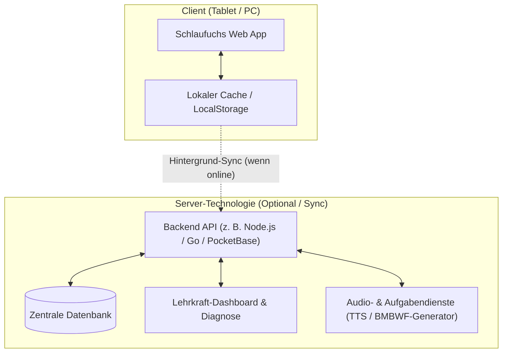

# Strategieplan: Einführung von Server-Technologie in Schlaufuchs

## 1. Ausgangslage: Der Status Quo (Static-Only)

Aktuell ist **Schlaufuchs** eine reine statische Web-Applikation (Vanilla HTML/CSS/JS, Caddy-Webserver, Datenhaltung in `LocalStorage`):

### Stärken der aktuellen Architektur:
* **100 % Offline-fähig:** Funktioniert ohne jede Internetverbindung im Klassenzimmer oder auf Reisen.
* **Maximale DSGVO-Sicherheit:** Keine personenbezogenen Daten von Volksschulkindern verlassen das Endgerät.
* **Zero Hosting-/Wartungskosten:** Jeder statische Webserver (Caddy, Nginx, GitHub Pages) reicht aus; keine Datenbank, keine Server-Updates.
* **Extrem hohe Geschwindigkeit:** Keine API-Latenzen, Berechnungen erfolgen in 0,1 Millisekunden direkt im Browser.

### Grenzen der aktuellen Architektur:
* **Gerätebindung:** Wechselt ein Kind vom Schul-iPad auf das Smartphone der Eltern, sind Sterne und Lernstand nicht synchronisiert (außer via manueller JSON-Sicherung).
* **Keine Klassenverwaltung für Lehrkräfte:** Eine Lehrerin kann nicht auf einen Blick sehen, wo 25 Kinder einer Schulklasse Förderbedarf haben.
* **Abhängigkeit von Client-Ressourcen:** Die Vorlesestimme hängt vom Betriebssystem ab (iOS hat tolle Stimmen, günstige Android-Tablets teils Roboter-Stimmen).
* **Statische Aufgabenmuster:** Neue Aufgaben oder Korrekturen erfordern ein neues Deployment der Web-Dateien.

---

## 2. Welche konkreten Vorteile brächte Server-Technologie?

Eine serverseitige Komponente würde Schlaufuchs von einem **persönlichen Übungstool** zu einer **schulweiten Lernplattform** ausbauen:

### Die 4 Hauptvorteile im Detail:

### A. Geräteübergreifender Sync & Kindgerechter Cloud-Login
* **Problem heute:** Browser-Cache gelöscht oder Gerät gewechselt = Fortschritt weg.
* **Mit Server:** Kind meldet sich per **Bild-Passwort**, **QR-Code-Karte** oder **4-stelligem Code** an.
* **Nutzen:** In der Schule auf Tablet A geübt $\rightarrow$ zu Hause auf dem Laptop genau dort weitergemacht, wo aufgehört wurde.

### B. Klassen-Dashboard & Diagnose-Zentrale für Lehrkräfte
* **Problem heute:** Lehrkraft muss zu jedem einzelnen Tablet gehen und die Diagnose manuell aufrufen.
* **Mit Server:**
  * **Klassenübersicht:** Eine Lehrerin sieht auf ihrem Dashboard die gesamte 2b (z. B. 24 Kinder).
  * **Kompetenz-Radar:** „18 von 24 Kindern beherrschen den Zehnerübergang; 6 Kinder brauchen noch Förderung.“
  * **Gezielte Zuweisung:** Lehrkraft kann einer Gruppe oder einem Kind gezielt Übungspakete freischalten („Hausübung bis Mittwoch: Schüttelsätze & Zwanzigerfeld“).

### C. Hochwertige Audio- & Inhalts-Dienste
* **Problem heute:** Die Browser-Sprachsynthese (`speechSynthesis`) klingt auf vielen Endgeräten metallisch oder bricht ab.
* **Mit Server:**
  * **Gecachte neuronale Audioausgabe:** Server kann Satzmuster vorrendern und glasklare österreichische Stimmen liefern.
  * **Dynamische Aufgabenbank:** Zusätzliche Lesetexte, Sachunterricht-Fragen und Rechengeschichten können über ein Redaktionssystem eingepflegt werden, ohne Code anfassen zu müssen.

### D. Kollaborative Lernszenarien (Klassen-Challenges)
* **Klassen-Quiz:** Live-Rennen („Wer löst 10 Aufgaben zuerst?“) im Stile von Kahoot, aber pädagogisch leise und lehrplankonform.
* **Gemeinsames Klassenziel:** „Wenn die 3a zusammen 500 Sterne sammelt, wird das nächste Tier-Memory-Set freigeschaltet.“

---

## 3. Risiken & Rahmenbedingungen (Österreichischer Schulkontext)

Bevor ein Server eingeführt wird, müssen die Rahmenbedingungen bedacht werden:

| Kriterium | Statische Architektur (Heute) | Mit Server-Technologie |
| :--- | :--- | :--- |
| **DSGVO / Datenschutz** | 🟢 **Ideal:** Keine Schülerdaten auf Servern. | ⚠️ **Aufwand:** AV-Vertrag, Datenschutzerklärung, Hosting ausschließlich in der EU/Österreich, Pseudonymisierung. |
| **Schul-WLAN Ausfallsicherheit** | 🟢 **100 % zuverlässig:** Läuft selbst im Flugmodus. | ⚠️ **Gefahr:** Bricht das Schul-WLAN zusammen, stockt der Unterricht (außer bei Local-First). |
| **Wartung & Betriebskosten** | 🟢 **Nahezu 0 € / 0 Std.:** Statische Files auf Caddy. | ⚠️ **Laufend:** DB-Backups, SSL, Security-Updates, API-Monitoring. |
| **Komplexität** | 🟢 Einfach zu warten und zu testen. | ⚠️ Authentifizierung, Session-Handling, Migrationen. |

---

## 4. Empfohlene Architektur: Das „Local-First“-Paradigma

> [!IMPORTANT]
> **Empfehlung:** Falls ein Server eingeführt wird, sollte **auf keinen Fall** eine reine Online-Client-Server-Applikation gebaut werden.  
> Der Goldstandard für Bildungstools ist **„Local-First“**:

1. **Die App bleibt im Kern 100 % lokal & offlinefähig:**  
   Alle Aufgaben, Generatoren, Übungen und Logiken laufen weiterhin im Browser des Kindes.
2. **Der Server ist eine optionale Ergänzung:**  
   * Ist Internet vorhanden: Automatischer, leiser Hintergrund-Sync von Sternen und Lernständen.
   * Ist kein Internet vorhanden: Die App funktioniert uneingeschränkt weiter und synchronisiert sich, sobald wieder WLAN da ist.
3. **Leichtgewichtiger Backend-Stack:**
   * **Option 1 (PocketBase / Go):** Eine einzige schlanke Executable, SQLite-basiert, extrem ressourcenschonend, läuft perfekt neben Caddy auf `minoris.local`. Bietet Auth, DB, Admin-UI und REST-API out of the box.
   * **Option 2 (Node.js Express / Fastify):** Maßgeschneidert für bestehende JS-Kenntnisse, einfache Erweiterung für Druck- und PDF-Export.

---

## 5. Konkrete Entscheidungsmatrix

* **Szenario 1: Schlaufuchs bleibt reines Eltern-/Kind-Übungstool für zu Hause:**  
  $\rightarrow$ **Kein Server nötig.** Die aktuelle statische PWA ist wartungsarm, blitzschnell und datenschutzrechtlich unschlagbar.
* **Szenario 2: Schlaufuchs soll an Volksschulen im Unterricht eingesetzt werden:**  
  $\rightarrow$ **Server unverzichtbar**, weil Lehrkräfte Klassen anlegen, Tablets synchron halten und Lernstandsanalysen sehen müssen.
* **Szenario 3: Cross-Device Nutzung zwischen Schul-Tablet und Eltern-Smartphone:**  
  $\rightarrow$ **Local-First Sync Backend** (z. B. PocketBase) als nächste Ausbaustufe.
