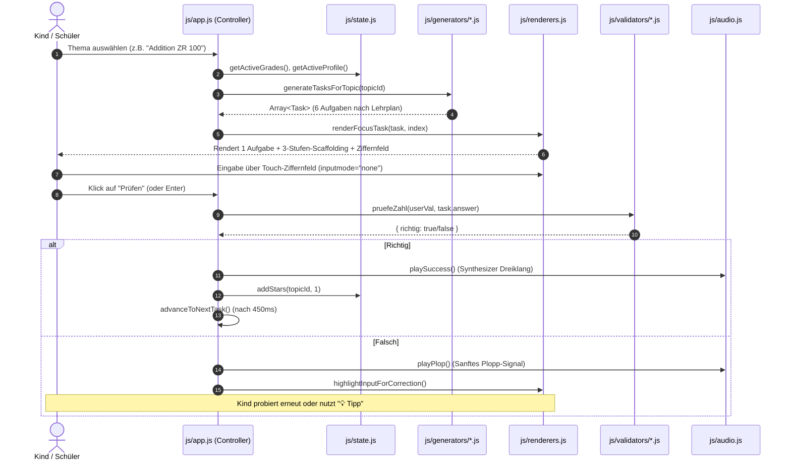

# Technische Dokumentation – Schlaufuchs (Lernplattform Volksschule Österreich)

> **Status:** Produktiv / Meilenstein 3 abgeschlossen  
> **Gültiger Lehrplan:** BMBWF Volksschul-Lehrplan 2023/2025 (BGBl. II Nr. 178/2025)  
> **Architektur-Typ:** 100% Offline-fähige Progressive Web App (PWA), Vanilla ES6+ ohne Build-Schritt  
> **Letzte Aktualisierung:** Oktober 2026

---

## Inhaltsverzeichnis

1. [Übersicht & Leitphilosophie](#1-übersicht--leitphilosophie)
2. [Gesamtarchitektur & Modulstruktur](#2-gesamtarchitektur--modulstruktur)
3. [PWA- & Offline-Infrastruktur](#3-pwa---offline-infrastruktur)
4. [Zustandsverwaltung, Persistenz & Datenmodelle](#4-zustandsverwaltung-persistenz--datenmodelle)
5. [Fachdidaktische Anschauung & Scaffolding-Engine](#5-fachdidaktische-anschauung--scaffolding-engine)
6. [Touch- & Input-Management (iPad-Schutz)](#6-touch---input-management-ipad-schutz)
7. [Audio-Architektur (TTS & Synthesizer)](#7-audio-architektur-tts--synthesizer)
8. [Design-System & Barrierefreiheit (Anti-KI-Look)](#8-design-system--barrierefreiheit-anti-ki-look)
9. [Lehrplankonformität & Normen (DIN/ÖNORM 1083)](#9-lehrplankonformität--normen-dinönorm-1083)
10. [Teststrategie, Linter & Quality Gates](#10-teststrategie-linter--quality-gates)
11. [Wartung, Deployment & Entwicklungsleitfaden](#11-wartung-deployment--entwicklungsleitfaden)

---

## 1. Übersicht & Leitphilosophie

**Schlaufuchs** ist eine browserbasierte Lern- und Festigungsplattform für Kinder der 1. bis 4. Schulstufe (6–10 Jahre) in österreichischen Volksschulen. Sie dient dem selbstständigen Festigen im Unterricht oder zu Hause.

### Kernprinzipien (Architektur-Manifest)

1. **Datenschutz & Kindersicherheit (Zero-Data-Exfiltration):**
   * Keine Speicherung von Klarnamen (ausschließlich Spitzname + Avatar).
   * Keine Cookies, keine Tracker, keine CDNs, keine externen Webfonts, keine Cloud-Anbindung.
   * Sämtliche Daten verbleiben lokal auf dem Gerät (`localStorage`).
2. **Klassenzimmer-Offline-Garantie:**
   * Nach dem ersten Aufruf im Browser ist die gesamte Anwendung dank Service Worker und Cache-First-Strategie auch bei komplett getrennter Internetverbindung (WLAN-Ausfall, Flugmodus) zu 100 % funktionsfähig.
3. **Pädagogische Ruhe statt SaaS-Gamification:**
   * Keine Bestrafungen, keine roten Fehlersignale, keine aggressiven Töne, kein Zeitdruck, keine Ranglisten, keine Suchtmechaniken (Streaks).
   * Genau **eine** Aufgabe im kognitiven Fokus; Belohnungen (Sterne, Sticker, Urkunden) erst auf der Abschlussseite.
4. **Schulbuch- statt KI-Optik:**
   * Ästhetik eines hochwertigen österreichischen Schulbuchs (flache 2px-Konturen, warmes Papier `--papier`, 0 Schatten, 0 Farbverläufe).
   * Authentische Typografie durch Einbettung der offiziellen österreichischen Schulschrift (*Primae*).
5. **Wartbarkeit ohne Build-Hürden:**
   * Kein Node-Bundler (kein Webpack/Vite zwingend nötig), keine transpilierten Frameworks (React/Vue).
   * Native ES6+ Module / IIFE-Namespaces, direkt im Browser lauffähig und debuggbar.

---

## 2. Gesamtarchitektur & Modulstruktur

Das System folgt einer strikten Trennung der Zuständigkeiten (Separation of Concerns). Alle Module sind unter dem globalen Namensraum `window.Schlaufuchs` registriert.

```
/
├── index.html                  # Single Page Application Shell & Focus-Container
├── manifest.webmanifest        # W3C Web App Manifest (PWA)
├── sw.js                       # Service Worker (Cache-First Offline Engine)
├── css/
│   ├── tokens.css              # Single Source of Truth für Design-Tokens (Farben, Maße)
│   ├── base.css                # Schulschrift Primae, Resets & Body-Defaults
│   ├── layout.css              # App-Shell, Header, Menü-Grid & Fokus-Modus
│   ├── components.css          # Standard-Aufgabenkarten, 64px Numpad, Scaffolding
│   ├── exercises.css           # Didaktische Fachmodule (Mathe, Deutsch, StVO, Uhren)
│   ├── stickers.css            # Panini-Sammelalbum, Booster & Trophäen-Vitrine
│   ├── admin.css               # Eltern- & Lehrerbereich, PIN-Schutz, Diagnostik
│   └── print.css               # A4-Arbeitsblatt-Engine, Knickstreifen, Urkunden
├── style.css                   # Aggregiertes Manifest (@import) für Abwärtskompatibilität
├── fonts/                      # Lokale Schulschriften (Primae-Regular, PrimaeText)
├── assets/
│   ├── icons/                  # 3px-Monochrom-SVG-Icons (keine Emojis in Bedienteilen)
│   └── verkehrszeichen/        # Offizielle StVO-Verkehrszeichen als Vektorgrafiken
├── js/
│   ├── core/                   # Basisdienste & Infrastruktur
│   │   ├── format.js           # ÖNORM 1083 Zahlformatierung (Spatium) & Parser
│   │   ├── random.js           # Seedbarer Zufallszahlengenerator (Mulberry32)
│   │   ├── storage.js          # Resiliente LocalStorage-Kapselung mit Memory-Fallback
│   │   └── texte.js            # Österreichischer Wortschatz & Textbausteine
│   ├── generators/             # Reine, zustandslose Datenfabriken (Task-Modelle)
│   │   ├── math.js             # Rechnen ZR 20, 100, 1000, 1 000 000, Geometrie, Größen
│   │   ├── german.js           # Wortarten, Groß-/Kleinschreibung, Schüttelsätze, PIRLS
│   │   ├── general.js          # Sachunterricht: Verkehrszeichen, Bundesländer, Natur
│   │   └── brain.js            # Konzentration, Muster, Zahlenfolgen, Raumorientierung
│   ├── validators/             # Reine Prüflogik (DOM-unabhängig & unit-testbar)
│   │   └── index.js            # Zahl-, Wort- und Strukturvalidatoren
│   ├── renderers/              # Modularisierte DOM-Renderer nach didaktischen Domänen
│   │   ├── scaffolding.js      # Fachdidaktisches Scaffolding (Rechenstrich)
│   │   ├── shell.js            # Standardisierte 3-Zonen-Bühne & Aktionsleiste
│   │   ├── math.js             # Gleichungen, Pyramiden, Schriftlich, 20er-Feld
│   │   ├── german.js           # Wortarten, Schüttelsätze, Leseverständnis
│   │   ├── clocks.js           # Analoge Uhr, Uhr stellen, 4-Uhren-Auswahl
│   │   └── general.js          # Multiple Choice, Memory, Muster, Sequenzen
│   ├── renderers.js            # Aggregierte Fassade für Abwärtskompatibilität
│   ├── app.js                  # Haupt-Controller: Routing, Focus-Mode, Numpad-Bridge
│   ├── state.js                # Globaler State & Publish-Subscribe Event-Bus
│   ├── audio.js                # Hybrid Web Audio Synthesizer + SpeechSynthesis (de-AT)
│   ├── admin.js                # Eltern-/Lehrkraft-Portal, Profilverwaltung & JSON-Backup
│   ├── stickers.js             # Virtuelles Sticker-Sammelheft
│   ├── print.js                # Vektoroptimierter Arbeitsblatt- & Urkundendruck
│   └── confetti.js             # Physikalisches Canvas-Konfetti für Abschlusskarten
├── tests/                      # Automatisierte Unit-Tests (Node Testrunner)
│   ├── format.test.mjs         # Prüft ÖNORM Spatium, Komma und Toleranz
│   ├── generators.test.mjs     # Prüft Lehrplan-Zuordnung & Schulstufen-Grenzen
│   ├── storage.test.mjs        # Prüft Persistenz & Quota-Fallback
│   └── validators.test.mjs     # Prüft Rechen-, Text- und Mauer-Prüfungen
└── scripts/
    └── check-regeln.mjs        # Statischer Code-Linter für verbindliche AGENTS.md-Regeln
```

### Datenfluss im Übungsbetrieb



---

## 3. PWA- & Offline-Infrastruktur

### Web App Manifest (`manifest.webmanifest`)
Die Anwendung deklariert sich als vollwertige, eigenständige Applikation:
* **Display Mode:** `standalone` (blendet Adressleiste und Browser-Chrome aus).
* **Theme- & Background-Color:** `#FBF7EE` (identisch mit Token `--papier`).
* **Sprachauszeichnung:** `de-AT` (für Screenreader und Sprachengines).
* **Ausrichtung:** `any` (vollständige Unterstützung von iPad Landscape- und Portrait-Haltern).

### Service Worker (`sw.js`)
Der Service Worker verfolgt eine deterministische **Cache-First-Strategie**:
1. **Pre-Caching im `install`-Event:** Alle statischen Assets (HTML, Stylesheets, Skripte, SVG-Icons, Verkehrszeichen und `.otf`-Schriftdateien) werden in einem benannten Cache (`schlaufuchs-vX.Y`) abgelegt.
2. **Sofortige Aktivierung:** `self.skipWaiting()` im Install-Event und `clients.claim()` im `activate`-Event garantieren, dass Updates ohne mehrfachen Reload greifen.
3. **Automatisches Cache-Busting:** Alte Cache-Instanzen werden beim Versionssprung automatisch dereferenziert und gelöscht.
4. **Sichere Initialisierung:** In `index.html` wird die Registrierung nur ausgeführt, wenn das Protokoll `http:` oder `https:` ist. Dies ermöglicht Entwicklern das problemlose Testen über das lokale `file://`-Protokoll ohne Konsolenfehler.

---

## 4. Zustandsverwaltung, Persistenz & Datenmodelle

### State Management (`js/state.js`)
Ein leichtgewichtiger Event-Bus steuert den Anwendungszustand ohne externe Abhängigkeiten:
* **Events:** `profile-changed`, `profiles-updated`, `stars-changed`, `grades-changed`, `settings-changed`.
* **Abonnement:** Komponenten registrieren sich via `State.subscribe(callback)`.

### Persistenz-Schicht (`js/core/storage.js`)
* Alle Schlüssel im Browser-`localStorage` besitzen das Präfix `schlaufuchs_`.
* **Sicherheits-Fallback:** Wirft der Browser bei vollem Speicher oder im privaten Modus einen `QuotaExceededError`, schaltet das Modul transparent auf einen transienten Memory-Store um, ohne dass die Anwendung abstürzt.

### Zentrales Aufgabenmodell (`Task`)
Jedes von den Generatoren erzeugte Aufgabenobjekt folgt verbindlich dieser Struktur:

```typescript
interface Task {
  fach: 'mathe' | 'deutsch' | 'sachunterricht' | 'gehirn';
  schulstufe: 1 | 2 | 3 | 4;         // Verbindliche Zuordnung laut Lehrplan
  lehrplanRef: string;               // z.B. "M-2-Operationen", "D-1-Erstlesen"
  type: string;                      // Renderer-Schlüssel (z.B. "equation", "pyramid")
  grade: number;
  question?: string;                 // Textuelle Aufgabenstellung
  num1?: string | number;            // Operand 1 (ÖNORM formatiert)
  num2?: string | number;            // Operand 2 (ÖNORM formatiert)
  symbol?: '+' | '−' | '·' | ':';   // Mathematisches Zeichen nach AGENTS.md
  raw1?: number;                     // Numerischer Rohwert für Scaffolding
  raw2?: number;                     // Numerischer Rohwert für Scaffolding
  answer: number | string;           // Erwartete Soll-Lösung
  userAnswer?: string;               // Vom Kind eingegebener Wert
  isCorrect?: boolean | null;        // Validierungsstatus
  hint?: string;                     // Verbaler Hinweis
}
```

### JSON-Backup-Schema (Lehrkräfte-Export)
Über den Admin-Bereich kann der gesamte Lernstand exportiert und importiert werden:

```json
{
  "version": "1.0",
  "exportDate": "2026-10-04T14:40:00.000Z",
  "profiles": [
    {
      "id": "p_1728045600",
      "name": "Lotta",
      "avatar": "🦊",
      "stars": { "math-add": 12, "de-wortarten": 8 },
      "stickers": ["fuchs_gold", "eule_lese"],
      "allowedGrades": [2]
    }
  ],
  "settings": {
    "soundEnabled": true,
    "activeGrades": [1, 2, 3, 4]
  }
}
```

---

## 5. Fachdidaktische Anschauung & Scaffolding-Engine

Gemäß dem **EIS-Prinzip** (Enaktiv $\rightarrow$ Ikonisch $\rightarrow$ Symbolisch nach Jerome Bruner) und den Vorgaben des BMBWF bietet Schlaufuchs ein 3-stufiges gestuftes Hilfesystem (Scaffolding), das direkt in `js/renderers.js` integriert ist.

### Das 3-Stufen-System

1. **Stufe 1 (Verbaler Impuls / Kognitive Strategie):**  
   Aktiviert das Vorwissen des Kindes, ohne das Ergebnis vorwegzunehmen.  
   *Beispiel:* „Rechne zuerst bis zum nächsten Zehner (40), dann den Rest (3) dazu.“
2. **Stufe 2 (Didaktischer SVG-Rechenstrich):**  
   Rendert einen dynamischen, mathematisch exakten Vektor-Zahlenstrahl.  
   * Parabel-Sprungbögen (quadratische Bézier-Kurven `Q midX topY curX yBase`) visualisieren Teilschritte ($+20$, $+3$, $+5$).
   * Vollständig responsiv via `viewBox="0 0 520 88"`, nutzt Token-Farben (`--mathe`, `--tinte`, `--linie`).
3. **Stufe 3 (Halbschriftlicher Rechenweg / Zerlegung):**  
   Schlüsselt die Teilschritte schriftlich auf:  
   $37 + 20 = 57$  
   $57 + 3 = 60$  
   $60 + 5 = 65$

```
┌───────────────────────────────────────────────────────────┐
│ 37 + 28 = [   ?   ]               [💡 Tipp (2/3)] [Prüfen]│
├───────────────────────────────────────────────────────────┤
│ 💡 SCHRITT 1: DENKSTRATEGIE                               │
│ Rechne zuerst die Zehner (+20), dann zum nächsten Zehner. │
│                                                           │
│ 💡 SCHRITT 2: ANSCHAUUNG (RECHENSTRICH)                   │
│        +20            +3          +5                      │
│     ╭───────╮      ╭─────╮     ╭─────╮                    │
│ ────┴───────┴──────┴─────┴─────┴─────┴─────────>          │
│    37       57          60          65                    │
└───────────────────────────────────────────────────────────┘
```

---

## 6. Touch- & Input-Management (iPad-Schutz)

Ein zentrales Problem von Web-Apps im Volksschulunterricht auf Tablets (insbesondere iPads) ist das unkontrollierte Aufpoppen der nativen Systemtastatur, welche Übungsaufgaben nach oben schiebt oder verdeckt.

### Die Virtuelle Numpad-Architektur (`.child-numpad`)

* **Mindestzielgröße:** Alle Tasten besitzen eine Höhe/Breite von mindestens **56px** (`--ziel-min`).
* **Input-Fokus-Verfolgung:** Ein globaler `focusin`-Listener in `js/app.js` merkt sich stets das zuletzt aktive Eingabefeld (`lastFocusedInput`).
* **Hardware-Tastatur vs. Touch:**
  * Wenn das Ziffernfeld geöffnet ist, setzt `setNumpadMode(true)` auf allen Eingabefeldern des Aufgabencontainers `inputmode="none"`.
  * Das Kind kann Eingabefelder antippen, ohne dass iOS oder Android die Bildschirmtastatur einblendet.
  * Beim Schließen des Ziffernfelds wird der ursprüngliche Modus (`inputmode="numeric"`) wiederhergestellt.
* **Auto-Select bei Fehleingabe:** Bei einer falschen Antwort markiert `highlightInputForCorrection()` den fehlerhaften Text automatisch (`input.select()`). Das Kind tippt auf dem Numpad sofort die neue Ziffer ein, ohne zuvor manuell Backspace drücken zu müssen.

---

## 7. Audio-Architektur (TTS & Synthesizer)

Die Audio-Engine (`js/audio.js`) arbeitet **zu 100 % clientseitig ohne externe MP3-Dateien oder Netzwerkabrufe**:

### 1. Text-to-Speech (Vorlesefunktion für Erstleser)
* Nutzt die standardisierte W3C `SpeechSynthesis`-API.
* **Sprachfilter:** Bevorzugt explizit Stimmen mit Kennung `de-AT` (österreichisches Deutsch), um landestypische Betonungen und Begriffe unverfälscht wiederzugeben.
* **Filterung mathematischer Operatoren:** Ersetzt Sonderzeichen (`·`, `−`, `:`) vor der Sprachausgabe durch phonetisch saubere Worte („mal“, „minus“, „geteilt durch“).
* **Geschwindigkeit:** Mit Rate `0.92` bewusst leicht verlangsamt für Schulanfänger.

### 2. Generativer Web Audio API Synthesizer
* Klänge werden zur Laufzeit über mathematische Oszillatoren erzeugt.
* **Erfolgssound (`playSuccess`):** Harmonischer Dur-Dreiklang (C5: 523Hz, E5: 659Hz, G5: 784Hz, C6: 1046Hz) mit weicher Dreieckswelle (`triangle`) und exponentiellem Lautstärkeabfall.
* **Fehler-/Plopp-Signal (`playPlop`):** Kein unangenehmer Brummton, sondern ein sanftes, dumpfes Sinus-Ploppen (140Hz $\rightarrow$ 60Hz), das Frustration vermeidet.
* **Klassenzimmer-Mute:** Ein Klick auf den Lautsprecher im Header schaltet alle Audioausgaben stumm (`isMuted = true`), gespeichert in den Einstellungen.

---

## 8. Design-System & Barrierefreiheit (Anti-KI-Look)

Schlaufuchs distanziert sich bewusst vom austauschbaren SaaS-Stil gängiger KI-Frontends (Glassmorphism, Farbverläufe, grelle Neonfarben, Schattenwürfe).

### Single Source of Truth (`css/tokens.css`)

Alle visuellen Parameter sind als CSS-Variablen definiert:

| Token-Gruppe | Variablen | Zweck / Bedeutung |
|---|---|---|
| **Papier & Fläche** | `--papier: #FBF7EE`<br>`--flaeche: #F3EEDF` | Warmer, augenfreundlicher Zeichenblock-Hintergrund |
| **Linien & Kontur** | `--linie: #1E252B`<br>`--linie-leise: #C8C2B4` | 2px feste Konturen statt weicher Schatten (`--rahmen`) |
| **Fachfarben** | `--mathe: #2255A4`<br>`--deutsch: #C83232`<br>`--sach: #2E7D32` | Klassische Volksschul-Heftfarben (Blau, Rot, Grün) |
| **Didaktik-Status** | `--erfolg: #2E7D32`<br>`--nochmal: #C83232` | Ruhige Statusanzeigen ohne grelles Signallicht |
| **Touch-Maße** | `--ziel-min: 56px`<br>`--abstand-touch: 12px` | Verbindliche Mindestmaße für Kinderfinger nach AGENTS.md |
| **Typografie** | `--schrift-titel: 'Primae'`<br>`--schrift-text: 'PrimaeText'` | Lokale österreichische Schulschrift |

### Druckoptimierung (Print CSS)
Unter `@media print` werden alle Navigationselemente, Ziffernfelder, Audio-Buttons und Modale ausgeblendet. Aufgabenblätter und Urkunden werden in reinem Schwarz-Weiß mit scharfen Vektorkanten für handelsübliche Schuldrucker aufbereitet.

---

## 9. Lehrplankonformität & Normen (DIN/ÖNORM 1083)

Die Plattform implementiert verbindliche gesetzliche Vorgaben des österreichischen Lehrplans:

1. **Zahlenschreibweise (ÖNORM A 1083):**
   * **Niemals ein Tausenderpunkt!** (`1.000` ist im österreichischen Schulsystem verboten).
   * Ab 4 Ziffern wird zwingend ein schmales geschütztes Leerzeichen (Unicode `\u202F`) gesetzt: `1 000`, `25 000`, `1 000 000`.
   * Realisiert über `Schlaufuchs.formatZahl(num)`.
2. **Mathematische Zeichen:**
   * Multiplikation: Ausschließlich der zentrierte Malpunkt `·` (`\u00B7`). Kein Stern `*`, kein `x`.
   * Subtraktion: Echtes mathematisches Minuszeichen `−` (`\u2212`). Kein Bindestrich/Hyphen `-`.
   * Division: Ausschließlich der Doppelpunkt `:` (`\u003A`). Kein Schrägstrich `/`, kein `÷`.
3. **Österreichischer Wortschatz:**
   * Ausschließlich landesübliche Bezeichnungen: *Jänner* (nicht Januar), *Sessel* (nicht Stuhl), *Klasse* (nicht Schulklasse/Klassenzimmer), *Schultasche* (nicht Ranzen), *Mitvergangenheit* (nicht Präteritum).
4. **Schulstufen-Grenzen:**
   * **1. Klasse:** Zahlenraum bis 20; Zerlegung, Addition, Subtraktion. Streng **keine** Multiplikation und Division.
   * **2. Klasse:** Zahlenraum bis 100; Einmaleins (`·` und `:`), Rechnen mit Zehnerüberschreitung.
   * **3. Klasse:** Zahlenraum bis 1 000; Halbschriftliches Rechnen, schriftliche Addition und Subtraktion.
   * **4. Klasse:** Zahlenraum bis 1 000 000; Schriftliche Multiplikation und Division, Stellenwerttafel (E, Z, H, T, ZT, HT, M).

---

## 10. Teststrategie, Linter & Quality Gates

Ein mehrstufiges Prüfsystem sichert die Codequalität vor jedem Deployment:

### 1. Statische Regelprüfung (`scripts/check-regeln.mjs`)
Prüft die gesamte Codebase auf die Einhaltung der in `AGENTS.md` definierten Vorgaben:
* Verbietet unerlaubte Rechenzeichen (`*`, `/`, `➗`).
* Erkennt verbotene CSS-Schatten (`box-shadow`, `filter: drop-shadow`).
* Sucht nach unzulässigen Tailwind-Standardfarben.
* Stellt sicher, dass Aufgaben Schulstufen- und Lehrplanreferenzen besitzen.

Ausführung:
```bash
node scripts/check-regeln.mjs
```

### 2. Automatisierte Unit-Tests (`node --test`)
Verwendet den nativen Node.js-Testrunner ohne Drittbibliotheken:
* `tests/format.test.mjs`: Testet Spatium-Setzung, Komma als Dezimaltrenner und fehlertolerantes Kindereingaben-Parsing.
* `tests/generators.test.mjs`: Überprüft alle Generatoren auf Vorhandensein der Pflichtmetadaten und mathematische Gültigkeit der Operanden.
* `tests/storage.test.mjs`: Testet Prefixing, Fehlerresilienz und In-Memory-Fallback.
* `tests/validators.test.mjs`: Prüft die Auswertung von Zahlen, Texten, Multiple-Choice und Rechentürmen.

Ausführung:
```bash
node --test
```

---

## 11. Wartung, Deployment & Entwicklungsleitfaden

### Schritt-für-Schritt: Neues Thema hinzufügen

1. **Aufgabengenerator anpassen (`js/generators/<fach>.js`):**
   Neue Generator-Funktion implementieren. Wichtig: Immer `schulstufe` und `lehrplanRef` mitgeben!
   ```javascript
   function buildNeuesThemaTasks() {
     return [{
       fach: 'mathe',
       schulstufe: 2,
       lehrplanRef: 'M-2-Geometrie',
       type: 'multiple-choice',
       question: 'Wie viele Ecken hat ein Dreieck?',
       options: ['3 Ecken', '4 Ecken', '5 Ecken'],
       correctIndex: 0,
       answer: '3 Ecken'
     }];
   }
   ```
2. **Themenkatalog registrieren (`js/app.js`):**
   Themen-ID in `generateTasksForTopic(topicId)` aufnehmen.
3. **HTML-Kachel ergänzen (`index.html`):**
   Entsprechende Kachel mit `data-topic="neues-thema"` und `data-grades="2"` in das Grid einfügen.
4. **Validieren:**
   ```bash
   node scripts/check-regeln.mjs
   node --test
   ```

### Server-Deployment (`minoris.local` / Schuleigenes Intranet)

Die Auslieferung erfolgt typischerweise über Caddy oder Nginx auf einem lokalen Schulserver:

```bash
# 1. Dateien synchronisieren (ohne Metadaten und Git)
rsync -avz --exclude=".DS_Store" --exclude=".git" ./ minoris:/var/www/schlaufuchs/

# 2. Dateirechte für Webserver setzen
ssh minoris "chmod -R a+rX /var/www/schlaufuchs"

# 3. HTTP-Status prüfen
curl -I http://minoris.local/manifest.webmanifest
curl -I http://minoris.local/sw.js
```

### Empfohlene Caddy-Konfiguration (`Caddyfile`)

```caddy
minoris.local {
    root * /var/www/schlaufuchs
    file_server

    # PWA Manifest & Service Worker Header
    header /sw.js {
        Cache-Control "no-cache"
        Content-Type "text/javascript; charset=utf-8"
    }
    header /manifest.webmanifest {
        Content-Type "application/manifest+json; charset=utf-8"
    }

    # Sicherheit & Kinderschutz
    header {
        X-Content-Type-Options "nosniff"
        X-Frame-Options "DENY"
        Referrer-Policy "no-referrer"
        Permissions-Policy "camera=(), microphone=(), geolocation=()"
    }
}
```
